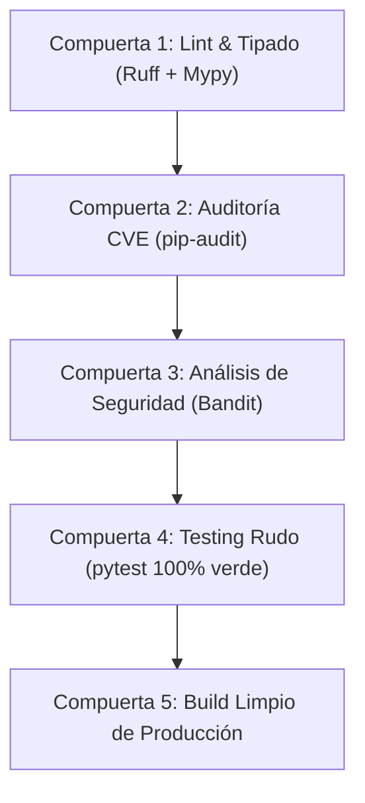

# 📖 GEMINI.md — La Biblia del Buen Desarrollador, Ingeniero de Software y Analista Programador

> **Regla de Oro Inquebrantable:**  
> *"No es un caso de éxito si no aprueba el testing riguroso. Código sin pruebas exhaustivas no es software: es una deuda técnica no declarada."*

---

## 🏛️ Manifiesto de Ingeniería de naxoresuelve

Este documento constituye el estándar canónico de ingeniería de software, arquitectura de sistemas, diseño de datos y gobernanza técnica para la plataforma **naxoresuelve**. Está redactado para elevar la disciplina técnica desde un nivel Junior hasta un nivel Mid-Level/Senior autónomo y riguroso.

### Principios Fundamentales
1. **Determinismo sobre Magia:** Ningún framework, ORM o librería debe ocultar el flujo de datos ni la complejidad temporal/espacial.
2. **Integridad Relacional Transaccional:** La base de datos PostgreSQL es la fuente de verdad definitiva. Se exige 3FN estricta, claves foráneas, restricciones `CHECK`, índices específicos y transacciones atómicas (ACID).
3. **Defensa en Profundidad (OWASP por Diseño):** La seguridad no se añade al final; se modela desde la definición de tipos, contratos de API, sanitización en fronteras y permisos mínimos de base de datos.
4. **Resiliencia Operativa:** Todo componente externo (base de datos, red, pasarelas de pago, APIs externas) fallará tarde o temprano. El software debe estar diseñado para degradar con elegancia (`503 controlado`), nunca crashear en cascada ni colgar hilos del servidor.

---

## 🔄 El Ciclo de Vida del Software (SDLC) Completo con Herramientas Open Source

A continuación se detalla cada etapa del ciclo de vida, los artefactos requeridos, las mejores prácticas de la industria y la matriz de herramientas 100% de código abierto.


---

### Fase 1: Levantamiento, Análisis y Diseño Orientado a Objetos (ADOO)

El objetivo de esta fase es erradicar la ambigüedad antes de escribir una sola línea de código ejecutable.

#### Prácticas Esenciales
- **Modelado por Dominios (DDD / Bounded Contexts):** Delimitar los dominios del sistema (`core`, `crm`, `identity`, `privacy`, `catalog`, `marketing`, `commerce`, `inventory`, `promotions`, `gamification`, `integrations`, `governance`).
- **Registros de Decisiones Arquitectónicas (ADR):** Cada cambio estructural relevante debe documentarse con Contexto, Decisión, Consecuencias y Alternativas descartadas (formato Markdown en `docs/architecture/adr/`).
- **Diagramas como Código (DaC):** Usar especificaciones declarativas legibles por Git.

#### Herramientas Open Source
| Categoría | Herramienta | Propósito / Uso |
| :--- | :--- | :--- |
| **Modelado & Diagramas** | **Mermaid.js** | Diagramas de secuencia, clases, entidad-relación y flujos renderizables en Markdown. |
| **Arquitectura de Software** | **PlantUML / Structurizr CLI** | Diagramas basados en el modelo C4 (Contexto, Contenedores, Componentes, Código). |
| **Bocetos & Whiteboarding** | **Excalidraw (FOSS)** | Bosquejos colaborativos de interfaces y modelos de dominio preliminares. |
| **Gestión de Requisitos** | **Markdown ADRs (`adr-tools`)** | Bitácora inmutable versionada en el árbol de Git. |

---

### Fase 2: Arquitectura y Modelado de Datos de Alto Rendimiento

#### Prácticas Esenciales
- **PostgreSQL 16+ Relacional Canónico:**
  - **Identificadores Únicos:** Uso de UUID v4 con `gen_random_uuid()` como llaves primarias en entidades distribuibles; enteros secuenciales reservados para orden cronológico interno.
  - **Precisión Monetaria:** Uso exclusivo de `NUMERIC(14,2)` o enteros en centavos. **Queda terminantemente prohibido usar `FLOAT` o `REAL` para importes monetarios** por pérdida de precisión binaria.
  - **Marcas Temporales UTC:** Uso estricto de `TIMESTAMPTZ` (Timestamp con zona horaria) almacenado siempre en UTC (`NOW()`).
  - **Estrategia de Índices:**
    - Índices B-Tree compuestos para consultas frecuentes (`tenant_id`, `status`, `created_at DESC`).
    - Índices parciales con filtro `WHERE` para estados activos (evita indexar registros archivados).
    - Índices GIN (`tsvector`) con diccionarios de idioma para búsquedas de texto eficientes (`spanish`).
  - **Minimización de Datos y Privacidad (Ley 19.628 y 21.719 de Chile):**
    - Endpoints de contacto (emails, números telefónicos) indexados mediante **HMAC-SHA256 determinista** (`endpoint_hmac BYTEA CHECK (OCTET_LENGTH(endpoint_hmac) = 32)`). La clave vive fuera de la base de datos para permitir listas de supresión y derecho de oposición sin almacenar el dato en claro.
  - **Patrón Transactional Outbox:** Evitar la doble escritura inconsistente entre la BD y brokers de mensajería; los eventos externos se guardan en la misma transacción que los datos del negocio (`integrations.outbox_messages`).

#### Herramientas Open Source
| Categoría | Herramienta | Propósito / Uso |
| :--- | :--- | :--- |
| **Motor de Base de Datos** | **PostgreSQL 16 / 18** | Motor transaccional ACID avanzado, soporte JSONB, RLS y extensiones. |
| **Migraciones de Esquema** | **Alembic / dbmate / Sqitch** | Versionado declarativo o secuencial de DDL con capacidades de rollback. |
| **Benchmarking & Stress DB** | **pgbench** | Generación de cargas de trabajo sintéticas concurrentes para validar bloqueos (deadlocks). |
| **Análisis de Consultas** | **`EXPLAIN (ANALYZE, BUFFERS)`** | Diagnóstico de lecturas de disco, escaneos secuenciales y uso de memoria. |

---

### Fase 3: Codificación Segura y Mitigación Integral del OWASP Top 10

Toda API desarrollada en **FastAPI** y todo frontend en **Next.js** deben cumplir las siguientes contramedidas:

#### 1. A01: Broken Access Control (Pérdida de Control de Acceso)
- Autenticación mediante tokens JWT estándar RFC 7519 con verificación obligatoria de firma criptográfica y expiración (`exp`).
- Control de acceso basado en roles (RBAC) validado explícitamente en el backend:
  ```python
  if current_user.get("role") != "admin":
      raise HTTPException(status_code=403, detail="Acceso restringido: requiere privilegios de Administrador")
  ```
- En base de datos, implementación de **Row-Level Security (RLS)** para aislar datos entre usuarios.

#### 2. A02: Cryptographic Failures (Fallas Criptográficas)
- Nunca almacenar contraseñas en texto claro ni con algoritmos rotos (MD5, SHA-1).
- Uso obligatorio de **PBKDF2-HMAC-SHA256 con 100.000 rondas** y salting criptográfico aleatorio único (`secrets.token_hex(16)`), o **Argon2id**.
- Verificación con mitigación de ataques de tiempo (*timing attacks*) usando `hmac.compare_digest()`.
- Exclusión estricta de hashes, sales y credenciales en las respuestas de endpoints (`UserOut` schema).

#### 3. A03: Injection (Inyección SQL, Comandos y XSS)
- **Cero interpolación de cadenas en SQL:** Uso exclusivo de consultas parametrizadas con `asyncpg` (`$1`, `$2`, ...). Jamás usar f-strings ni concatenación (`+`) en sentencias SQL.
- Tipado y validación estricta en la frontera mediante **Pydantic v2**:
  - `EmailStr` para forzar RFC 5322 y rechazar inyecciones SQL en cabeceras de correo.
  - `Field(min_length=..., max_length=...)` para acotar buffers de entrada.

#### 4. A04: Insecure Design (Diseño Inseguro) & Anti-DoS
- Límites máximos en cuerpos de petición (p. ej. `max_length=5000` en mensajes).
- Rate Limiting en endpoints públicos (`slowapi` / tokens bucket en Redis).
- Idempotencia en endpoints transaccionales mediante cabecera `Idempotency-Key`.

#### 5. A05: Security Misconfiguration (Configuración Errónea de Seguridad)
- Cabeceras de seguridad HTTP aplicadas en middleware:
  - `X-Content-Type-Options: nosniff`
  - `X-Frame-Options: DENY` (prevención de Clickjacking)
  - `X-XSS-Protection: 1; mode=block`
  - `Strict-Transport-Security: max-age=63072000; includeSubDomains; preload` (HSTS)
- Entorno de producción sin exposición de stack traces ni rutas locales del sistema de archivos (`C:\...`).

#### 6. A06: Vulnerable and Outdated Components (Componentes Vulnerables)
- Escaneo continuo de dependencias con `pip-audit`, `safety` y `npm audit`.
- Fijación exacta de versiones en `requirements.txt` y `package-lock.json`.

#### 7. A07: Identification and Authentication Failures (Fallas de Identificación)
- Rechazo tajante de algoritmos nulos en JWT (`alg: "none"`).
- Invalidación de credenciales vacías o nulas antes de consultar la base de datos.
- Bloqueo temporal de cuentas ante intentos sucesivos fallidos.

#### 8. A08: Software and Data Integrity Failures (Fallas de Integridad)
- Prevención de *Mass Assignment*: Pydantic descarta silenciosamente cualquier campo privilegiado inyectado por el usuario (`is_admin`, `role`, `id`).

#### 9. A09: Security Logging and Monitoring Failures (Fallas de Registro)
- Registro estructurado de eventos de seguridad en `governance.audit_events`.
- **Regla estricta de sanitización:** Jamás registrar en logs PII en claro (contraseñas, números de tarjeta, tokens Bearer).

#### 10. A10: Server-Side Request Forgery (SSRF)
- Rechazo de peticiones a rangos privados RFC 1918 (`10.0.0.0/8`, `172.16.0.0/12`, `192.168.0.0/16`, `127.0.0.1`, `localhost`) y direcciones de enlace local (`169.254.169.254`).

#### Herramientas Open Source
| Categoría | Herramienta | Propósito / Uso |
| :--- | :--- | :--- |
| **Análisis Estático de Seguridad (SAST)** | **Bandit** | Detección de fallos de seguridad comunes en código Python (hardcoded passwords, imports inseguros). |
| **Auditoría de Vulnerabilidades** | **pip-audit / OSV-Scanner** | Verificación de CVEs en librerías contra la base de datos Google OSV. |
| **Linters & Formateo** | **Ruff / Black** | Garantizar estándares PEP 8 y detectar antipatrones de rendimiento. |
| **Validación de Tipos** | **Mypy (modo estricto)** | Análisis estático de tipos sin tolerar `Any` descontrolados. |

---

### Fase 4: Testing Rudo & Aseguramiento de Calidad (QA)

#### Pirámide de Pruebas de naxoresuelve

```
         / \
        / E2E \       -> Pruebas de Flujo Completo (Playwright / Cypress)
       / Concurr \     -> Estrés, Fuzzing y Ráfagas (100+ reqs, Locust)
      / Integración \   -> TestClient + PostgreSQL real (asyncpg)
     /    Unitarias   \  -> Pydantic, Hashing, Lógica Pura (pytest)
    -------------------
```

#### Prácticas Esenciales
- **Fuzzing de Datos Sucios:** Bombardear los endpoints con payloads corruptos, emojis desbordados, inyecciones de bytes nulos (`\x00`), strings gigantescos y estructuras JSON inválidas. El sistema debe responder `422 Unprocessable Entity` sin desbordar memoria.
- **Tolerancia a Caídas (Chaos Engineering):** Probar el comportamiento de la API cuando la base de datos está desconectada. Debe responder `503 Service Unavailable` controlado, sin crashear el worker de Uvicorn ni arrojar excepciones no capturadas.
- **Pruebas de Concurrencia y Resistencia a Bloqueos:** Ráfagas de consultas simultáneas al event loop sin fugas de descriptores de sockets.

#### Herramientas Open Source
| Categoría | Herramienta | Propósito / Uso |
| :--- | :--- | :--- |
| **Suite de Testing Backend** | **pytest + pytest-asyncio** | Ejecución concurrente de pruebas parametrizadas y asíncronas. |
| **Cliente de Pruebas HTTP** | **HTTPX / Starlette TestClient** | Peticiones HTTP locales sin levantar sockets de red reales. |
| **Pruebas de Carga y Estrés** | **Locust (FOSS)** | Pruebas de carga masiva en Python para medir latencia p95 y p99. |
| **Pruebas E2E Frontend** | **Playwright** | Automatización de navegador para verificar accesibilidad y formularios. |

---

### Fase 5: Integración y Entrega Continua (CI/CD)

Todo commit o Pull Request debe superar obligatoriamente una batería de compuertas de calidad automatizadas:



#### Herramientas Open Source
| Categoría | Herramienta | Propósito / Uso |
| :--- | :--- | :--- |
| **Orquestación CI/CD** | **GitHub Actions / Forgejo / Gitea Actions** | Pipelines automatizados basados en contenedores. |
| **Empaquetado** | **Docker & Docker Compose** | Entornos reproducibles e idénticos entre desarrollo y producción. |
| **Gestión de Secretos** | **Gitleaks / Trufflehog** | Prevención de commits accidentales de API keys o contraseñas. |

---

### Fase 6: Despliegue, Operación y Gobernanza TI

#### Matriz de Madurez Técnica (Junior vs. Mid-Level)

| Dimensión | Desarrollador Junior | Ingeniero Mid-Level (Estándar naxoresuelve) |
| :--- | :--- | :--- |
| **Resolución de Errores** | Asume que el código funciona si no crashea en su máquina local. | Diseña pruebas parametrizadas con casos borde antes de considerar la tarea terminada. |
| **Manejo de Base de Datos** | Modifica tablas manualmente en pgAdmin o usa un ORM a ciegas. | Escribe migraciones versionadas con índices óptimos y mide `EXPLAIN ANALYZE`. |
| **Seguridad** | Confía en que el framework lo protege de todo. | Aplica principio de menor privilegio, HMAC a PII, sanea headers y previene OWASP Top 10. |
| **Gobernanza Git** | Realiza commits con mensajes genéricos (`fix`, `update`) directamente a `main`. | Utiliza *Conventional Commits* (`feat:`, `fix:`, `refactor:`), ramas temáticas y no pushea sin QA. |
| **Resiliencia** | Escribe `try ... except: pass` o deja que las excepciones suban al usuario. | Implementa degradación controlada (`503`), fallbacks claros y logging estructurado sin PII. |

#### Herramientas Open Source
| Categoría | Herramienta | Propósito / Uso |
| :--- | :--- | :--- |
| **Métricas & Monitoreo** | **Prometheus** | Recolección de métricas de latencia, tasa de errores y uso de CPU/RAM. |
| **Visualización** | **Grafana (OSS)** | Dashboards de monitoreo de endpoints y pools de conexión. |
| **Trazabilidad Distribuida** | **OpenTelemetry + Jaeger** | Rastreo de peticiones end-to-end a través de microservicios o base de datos. |
| **Backups & Recuperación** | **pg_dump / pgBackRest** | Respaldos transaccionales cifrados, incrementales y con política RTO < 1h. |

---

### Fase 7: Identidad, Gestión de Accesos & Cumplimiento Normativo Chileno

Esta fase consolida el estándar de gestión de identidades, privacidad y ciberseguridad bajo el marco legal de la **República de Chile** (Ley 19.628 y Ley 21.719 de Protección de Datos Personales, y Ley 21.663 Marco de Ciberseguridad 2024).

#### 1. Registro Seguro y Consentimiento Informado (Ley 19.628 / 21.719)
- **Consentimiento Libre, Expreso e Informado:**
  - Todo formulario de registro debe exigir la aceptación explícita de los Términos y Condiciones y la Política de Privacidad (`accept_terms: true`).
  - **Prohibición absoluta:** Las casillas de consentimiento **NUNCA deben estar pre-marcadas** (opt-in explícito obligatorio).
  - La finalidad de creación de cuenta (`account_management`) es independiente de las comunicaciones comerciales (`email_marketing`). La casilla de marketing debe ser opcional y desmarcada por defecto.
- **Validación Estricta:**
  - Correo electrónico validado contra RFC 5322 (`EmailStr`), normalizado a minúsculas y sin espacios.
  - Contraseñas con longitud mínima de 8 caracteres, hash PBKDF2-HMAC-SHA256 con 100.000 rondas y salting criptográfico aleatorio único de 16 bytes.

#### 2. Recuperación Criptográfica de Contraseñas (OWASP A07 & Ley 21.663)
- **Generación de Tokens de Alta Entropía:** Uso exclusivo de generadores seguros del sistema operativo (`secrets.token_urlsafe(32)`).
- **Cero Tokens en Texto Claro en Base de Datos:** El token transmitido al usuario se almacena en la tabla `password_resets` exclusivamente como su **hash SHA-256** (`token_hash = sha256(token)`).
- **Ventana de Validez Acotada:** Los tokens caducan de forma no negociable en **15 minutos** (`expires_at = NOW() + INTERVAL '15 minutes'`).
- **Uniuso Estricto:** Al momento de restablecer la clave, el token se invalida irrevocablemente (`is_used = TRUE`).
- **Prevención de Enumeración de Cuentas:** El endpoint `POST /auth/forgot-password` debe responder un mensaje neutro e idéntico tanto si el correo existe como si no existe, impidiendo a un atacante mapear qué usuarios están registrados.

#### 3. Federación de Identidad y Social Login (Google, Facebook, Instagram, Microsoft)
- **Estándares Abiertos:** Soporte de autenticación federada mediante **OpenID Connect (OIDC)** y **OAuth 2.0**.
- **Desacoplamiento Relacional:** Las cuentas federadas se asocian en la tabla `external_accounts` vinculadas a la entidad canónica `users.id`, permitiendo al usuario vincular múltiples proveedores a su misma identidad.
- **Minimización de Datos (Privacy by Design):** Solo se solicitan los scopes indispensables para autenticar (`openid`, `email`, `profile`). Nunca se solicitan permisos de lectura de contactos, muro ni publicación.
- **Defensa contra Escalación de Privilegios:** Toda cuenta creada vía OAuth social se inicializa de forma predeterminada con el rol `client`. Bajo ninguna circunstancia un login social hereda permisos de `admin` de forma automática.

#### Herramientas Open Source
| Categoría | Herramienta | Propósito / Uso |
| :--- | :--- | :--- |
| **Tokens & Criptografía** | **`secrets` / `hashlib` (Python)** | Generación de números pseudoaleatorios criptográficos (CSPRNG) y hashing SHA-256. |
| **Validación de Identidad** | **Authlib / PyJWT** | Validación y decodificación de tokens ID de Google, Facebook e Instagram. |
| **Auditoría de Consentimiento** | **PostgreSQL `privacy.consent_events`** | Bitácora inmutable append-only con timestamp UTC y versión de política aceptada. |

---

*Fin del Documento Canónico — naxoresuelve Engineering Standard 2026.*
